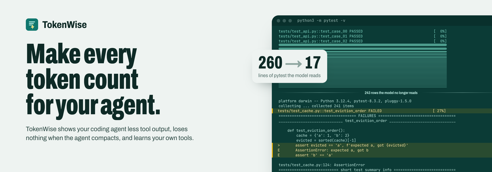
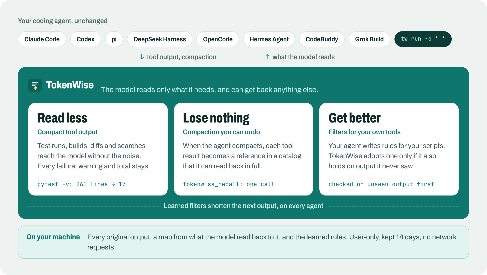
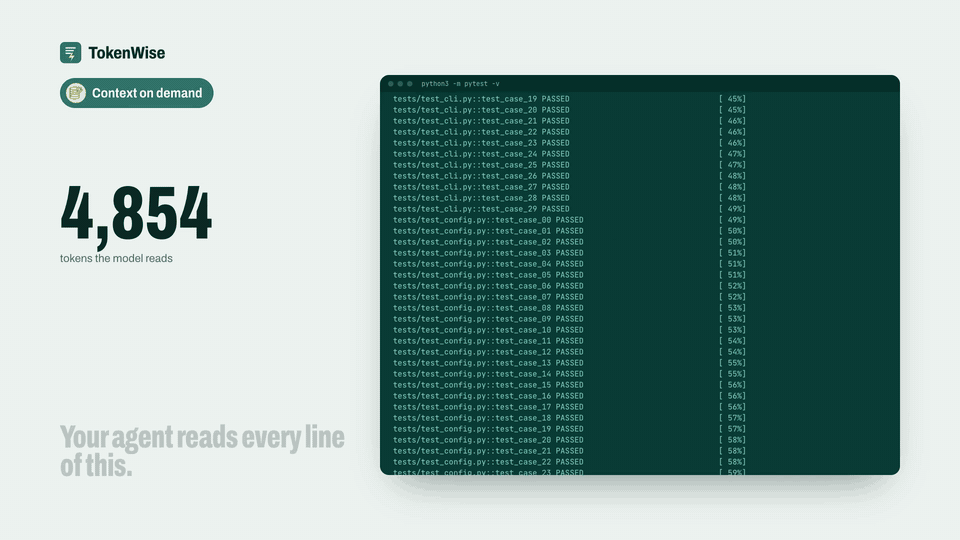
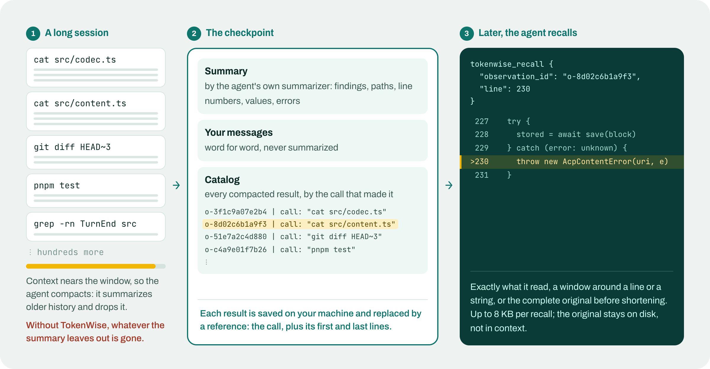
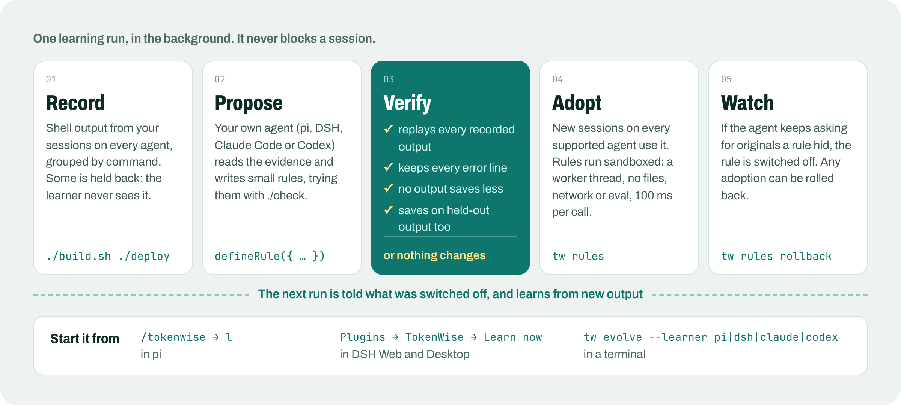

<div align="center">



<p>
  
  <a href="LICENSE"></a>
  
  
  
</p>

**English** · [简体中文](docs/zh/README.md)

[Watch the 1-minute video](media/video/tokenwise-en.mp4) · [中文视频](media/video/tokenwise-zh.mp4)

</div>

---

A coding agent spends most of its context window reading tool output: test
runs, builds, diffs, searches, whole files. Most of it is noise the model reads
once. Some of it is evidence the agent needs again an hour later, after it has
compacted its history and the summary left it out. The noise costs money, time
and attention; every lost detail costs a re-run or a wrong answer.

TokenWise plugs into the agent you already use and changes one thing: **the
model reads only what it needs, and can get back anything else.** It is not
another agent, it needs no configuration, and everything stays on your machine.

<p align="center"></p>

## How it works

### Read less

When the agent runs `pytest`, `cargo test`, `git diff`, `grep -rn`, `tsc`, a
package install or one of about 80 other recognized commands, the model reads a
shorter, deterministic version. Passing tests are counted instead of listed,
progress bars and repeated rows are folded, and long searches and diffs are
previewed with exact omission counts. Failures, warnings, totals and the exit
status always stay. The complete output is saved locally, and the short version
ends with one line telling the model how to read it.

<p align="center"></p>

### Lose nothing

Long sessions get compacted: the agent summarizes older history and throws it
away. With TokenWise, every tool result in that history is saved and replaced
by a reference naming the call that produced it. The new context carries the
summary, your own messages word for word, and a catalog of those references.
When the agent needs an exact line again, one `tokenwise_recall` call brings it
back: the text it saw, a window around a line or a string, or the complete
output before it was shortened.

<p align="center"></p>

### Get better

Built-in filters know common commands; your project has its own build scripts,
test runners and deploy logs. When you ask, your own agent studies the output
your sessions recorded and writes small filters for it. TokenWise adopts a
filter only after replaying every recorded output with it, and only if it also
saves tokens on output the learner never saw. A filter the agent keeps working
around switches itself off, and any adoption can be rolled back.

<p align="center"></p>

### What never changes

- **Strictly smaller, or the original.** A short version is used only if it is
  smaller and saves tokens.
- **Evidence stays.** Failure bodies, diagnostics, warnings and totals are kept;
  output a filter cannot fully recognize passes through unchanged.
- **Deterministic.** The same output always reads the same and is never
  re-rendered later, so prompt caches stay valid.
- **Fails open.** Any error delivers the original output, and a compaction
  TokenWise cannot improve is left to the agent.
- **Local.** Originals live under `~/.tokenwise`, readable only by you, for 14
  days. TokenWise makes no network requests of its own.

## Install

TokenWise is not on npm yet. Build it once from a checkout (Node.js 22 and
pnpm):

```sh
git clone https://github.com/Zongwei9888/tokenwise.git
cd tokenwise && pnpm install && pnpm build
npm install -g ./packages/cli          # the tokenwise command, tw for short
```

Then, from the same folder, add it to your agent:

```sh
# pi
pi install "$PWD/adapters/pi"

# DeepSeek Harness: Web, Desktop and CLI (use your own profile)
dsh plugin --profile web add "$PWD/adapters/dsh"

# Claude Code
claude plugin marketplace add "$PWD" && claude plugin install tokenwise@tokenwise

# Codex: afterwards, trust the hooks in /hooks
codex plugin marketplace add "$PWD" && codex plugin add tokenwise@tokenwise

# CodeBuddy
codebuddy plugin marketplace add "$PWD" && codebuddy plugin install tokenwise@tokenwise

# Grok Build
grok plugin marketplace add "$PWD" && grok plugin install tokenwise --trust

# OpenCode
mkdir -p ~/.config/opencode/plugins
cp adapters/opencode/dist/index.js ~/.config/opencode/plugins/tokenwise.js

# Hermes Agent
mkdir -p ~/.hermes/plugins
cp -R adapters/hermes/tokenwise ~/.hermes/plugins/tokenwise
hermes plugins enable tokenwise && hermes config set context.engine tokenwise

# Anything else: wrap the command
tokenwise run -c 'cargo test'
```

There is nothing to configure; it works from the next tool call.
`tokenwise report` shows what was saved and `tokenwise doctor` what your agent
supports. Each agent's folder under [`adapters/`](adapters) has the details.

## Supported agents

How deep TokenWise goes depends on what each agent lets a plugin do.

| Agent | Compact output | Compaction | Learned filters |
|---|---|---|---|
| **pi** 1.1+ | in-process | writes the checkpoint | yes |
| **DeepSeek Harness** 0.2.x | in-process | writes the checkpoint | yes |
| **OpenCode** 1.19+ | in-process | writes the checkpoint | yes |
| **Hermes Agent** 0.22+ | Python plugin | writes the checkpoint | yes |
| **CodeBuddy** 2.175+ | hook, via `tokenwise run` | rewrites the stored summary | wrapped commands |
| **Claude Code** 2.1+ | hook | adds the catalog | yes |
| **Codex** 0.162+ | hook, via `tokenwise run` | adds the catalog | wrapped commands |
| **Grok Build** 1.0+ | hook | adds the catalog | yes |
| **Any agent or shell** | `tokenwise run` | recall over MCP | yes |

*Writes the checkpoint*: TokenWise builds the compacted context itself.
*Adds the catalog*: the agent writes its own summary, which no plugin may
replace, and TokenWise adds the catalog right after it.

Tests run on macOS and Linux; Windows is not tested yet. Connecting another
agent takes a thin adapter over the same core; [docs/adapters.md](docs/adapters.md)
shows how.

<details>
<summary>Inside pi and DeepSeek Harness: the panel, learning, rolling back</summary>
<br>

In **pi**, `/tokenwise` opens a panel with the session's savings, the learned
filters and the commands worth learning from. Press `l` to learn and `r` to
roll an adoption back.

In **DeepSeek Harness** (Web and Desktop), the plugin's page has **Learn now**,
live progress, the learned filters with a switch and **Roll back**, and a toast
when there is new output worth learning from.

<p align="center"></p>

The screenshot comes from the end-to-end suite, which drives the real app with a
scripted model.

</details>

## Commands

| Command | What it does |
|---|---|
| `tokenwise report [--host H] [--session S] [--json]` | what was saved, per session or agent |
| `tokenwise doctor [--json]` | configuration, and what each agent supports |
| `tokenwise run -c '<command>'` | run a command and print the compact output |
| `tokenwise recall <id> [--query Q \| --line N] [--original]` | read a saved result back |
| `tokenwise mcp` | an MCP server with the recall tool, for any agent |
| `tokenwise evolve --learner pi\|dsh\|claude\|codex\|"<command>"` | learn filters from your recorded output |
| `tokenwise rules [list\|show\|off\|rollback]` | manage learned filters |
| `tokenwise filters`, `show <sha256>`, `gc` | built-in filters, a saved original, cleanup |

`tw` works in place of `tokenwise` everywhere.

## Configuration

None is needed. To change something, write `~/.tokenwise/config.json`:

```json
{
  "output": { "mode": "apply", "minimumSavedTokens": 16, "evidence": true, "learnedRules": true },
  "compaction": { "mode": "apply" },
  "artifacts": { "retentionDays": 14 }
}
```

`output` covers compact output and learning, and `compaction` covers compaction.
Each can be `apply`, `observe` (record what would change, change nothing) or
`off`. A project's `.tokenwise/config.json` can only turn things down, and
`TOKENWISE_DISABLE=1` switches everything off.

## Privacy

Everything stays on your machine. Saved originals can contain whatever your
commands printed, including secrets, so they are readable only by you and
deleted after the retention period. The one thing that leaves your machine is a
learning run you start yourself: the learner is your own coding agent, so the
recorded output it reads goes to that agent's model provider, just as it did
when the agent first ran the commands. Set `"evidence": false` to record nothing.

## How it is tested

| Layer | What runs |
|---|---|
| Unit | 1,095 tests across the core and every adapter, with agent payloads and transcripts captured from the real agents |
| Conformance | every implementation must reproduce the expected compact outputs byte for byte |
| End to end | the packed plugins installed into published pi and DeepSeek Harness releases and driven through their own UI, on Linux and macOS in CI |
| Real models | long sessions on all eight agents, at default and lowered compaction thresholds, with exact-quote questions afterwards |

## Development

```sh
pnpm install
pnpm check        # typecheck, build, all unit tests
pnpm e2e          # install into published agent releases and run real sessions
```

| Path | Contents |
|---|---|
| `packages/core` | filters, the learned-filter sandbox, source maps; no agent dependency |
| `packages/protocol` | capabilities, agent profiles, negotiation, journal schema |
| `packages/store` | journal, saved originals, learned filters, configuration |
| `packages/mechanisms` | compact output, compaction, learning |
| `packages/cli` | the `tokenwise` command |
| `adapters/<agent>` | one thin adapter per agent |
| `conformance/` | the byte-for-byte corpus |
| `e2e/` | the end-to-end suite against published agent releases |

Further reading: [architecture](docs/architecture.md),
[adding an agent](docs/adapters.md), [releasing](docs/releasing.md),
[media kit](media/README.md), [changelog](CHANGELOG.md).

## License

MIT. The RTK filter data in `packages/core/src/rtk/` is Apache-2.0; see
[`third-party/rtk`](third-party/rtk/NOTICE.md).
