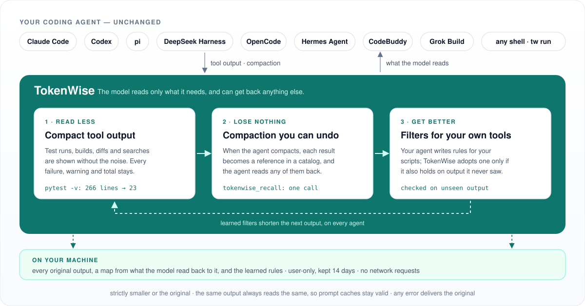
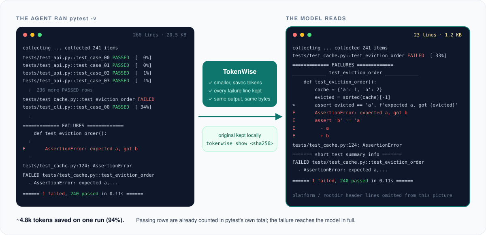
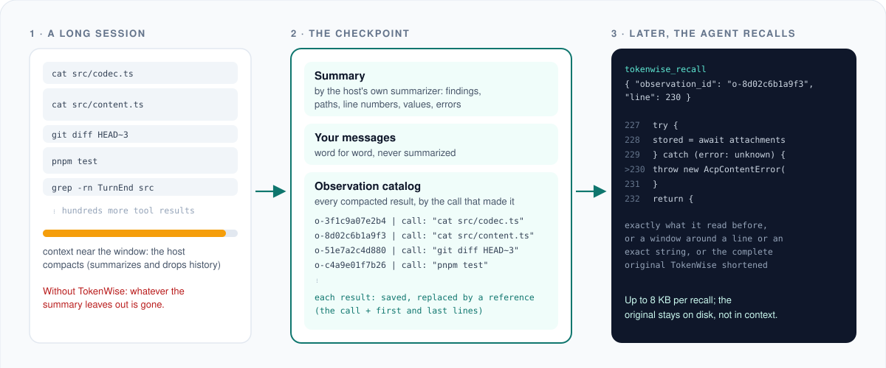
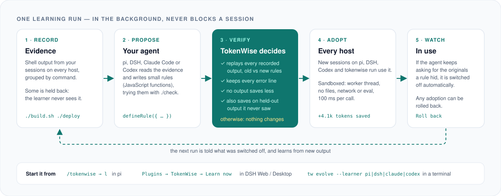
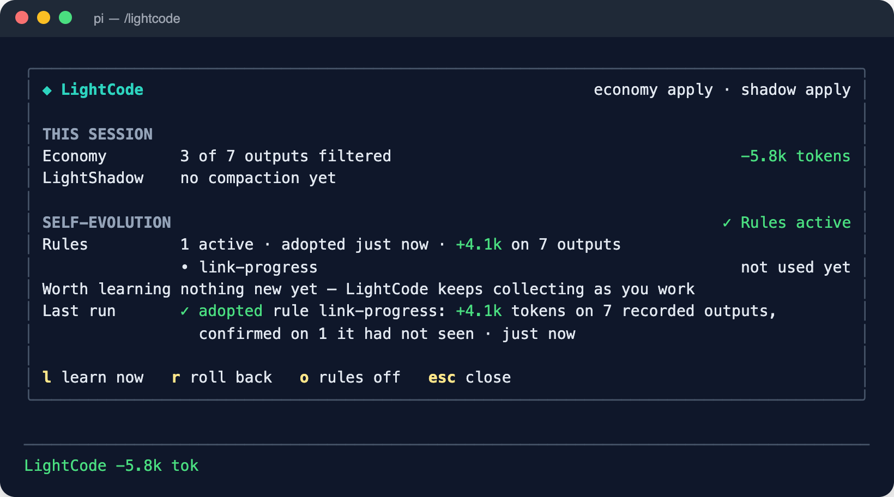
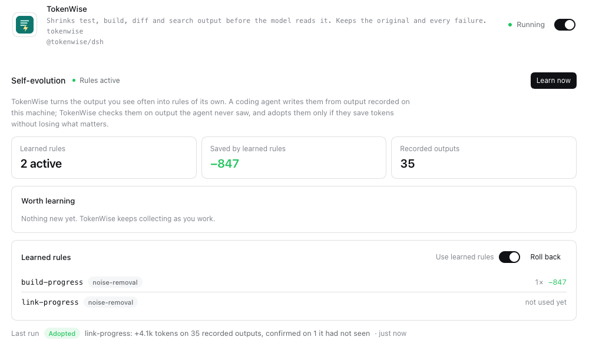

<div align="center">


# TokenWise

### Make Every Token Count for Your Agent

A plugin for the coding agent you already use. It shows the model less tool output,<br>
loses nothing when the agent compacts, and learns your own tools as you work.

<p>
  
  <a href="LICENSE"></a>
  
  
  
</p>

<p>
  <a href="README.md"></a>&nbsp;
  <a href="docs/zh/README.md"></a>
</p>

[Why](#why-tokenwise) · [How it works](#how-it-works) · [Results](#results-on-real-sessions) · [Install](#install) · [Agents](#supported-agents) · [Commands](#commands) · [Development](#development)

</div>

---

## Why TokenWise

A coding agent spends most of its context window reading tool output: test
runs, builds, diffs, searches, whole files. Most of it is noise the model
reads once. Some of it is evidence the agent needs again an hour later, after
the agent has compacted its history and the summary left it out. Every token
of that noise costs money, time and attention, and every lost detail costs a
re-run or a wrong answer.

TokenWise plugs into the agent you already use, at the points the agent
offers plugins, and changes one thing: **the model reads only what it needs,
and can get back anything else.** It is not another agent, it needs no
configuration, and everything stays on your machine.

<div align="center">

</div>

## How it works

It is one idea applied at every point where tokens are spent.

**Every tool result is shown compact.** When the agent runs `pytest`,
`cargo test`, `git diff`, `grep -rn`, `tsc`, a package install or one of ~80
other recognized commands, the model reads a shorter, deterministic version:
passing tests are counted instead of listed, progress bars and repeated rows
are folded, long searches and diffs are previewed with exact omission counts.
Failures, warnings, totals and the exit status are always kept. The complete
output is saved on your machine, and the shortened version ends with one line
telling the model how to read it if it needs to.

<div align="center">

</div>

**Every compaction keeps what it drops.** Long sessions get compacted: the
agent summarizes older history and throws it away. With TokenWise, each tool
result in that history is saved and replaced by a reference that names the
call that produced it. The new context carries the summary, your own messages
word for word, and a catalog of those references. When the agent needs an
exact line again, it reads it back with one call (`tokenwise_recall`): the
text it saw, a window around a line or a string, or the complete output
before it was shortened.

<div align="center">

</div>

**Every session teaches it your tools.** Built-in filters know common
commands; your project has its own build scripts, test runners and deploy
logs. When you ask, your own agent studies the output your sessions recorded
and writes small filters for it. TokenWise adopts a filter only after
replaying every recorded output with it, and only if it also saves tokens on
output the learner never saw. A filter the agent keeps working around is
switched off on its own, and any adoption can be rolled back.

<div align="center">

</div>

### The rules it never bends

- **Strictly smaller, or the original.** A shorter version is used only if it
  is smaller and saves tokens; otherwise the model reads the original.
- **Evidence stays.** Failure bodies, diagnostics, warnings and totals are
  kept; output a filter cannot fully recognize passes through unchanged.
- **Deterministic.** The same output always reads the same and is never
  re-rendered later, so prompt caches stay valid.
- **Fails open.** Any error, anywhere, delivers the original output, and a
  compaction TokenWise cannot improve is left to the agent.
- **Local.** Originals are kept under `~/.tokenwise` with user-only
  permissions for 14 days. TokenWise makes no network requests of its own.

## Results on real sessions

Long real tasks, each agent at its **default** compaction settings, run until
the agent compacted on its own. Afterwards the agent had to quote, exactly,
lines it had read before the compaction.

| Agent · model | Compacted history → what the model kept | Saved results | Afterwards |
|---|---|---|---|
| pi · DeepSeek V4 (1M) | 949k → 29.5k tokens | 624 | 2 recalls, every answer correct |
| DeepSeek Harness · DeepSeek V4 (1M) | 539k → 30.8k tokens | 589 | 2 recalls, every answer correct |
| pi · Kimi K2.6 (262k) | 274k → 8.0k tokens | 113 | 3 recalls, every answer correct |
| OpenCode · Kimi K2.6 (262k) | 190k → 7.1k tokens | 67 | every answer correct |
| Hermes Agent · Kimi K2.6 (262k) | 180k → 8.9k tokens | 83 | 8 recalls, every answer correct |
| Grok Build · default model | 199k span; catalog added after Grok's summary | 82 | every answer correct |
| Claude Code · everyday session | automatic compaction at 661k; catalog added after Claude's summary | 202 | — |

In the 262k runs each agent fixed six bugs against a 720 KB specification and
then copied 60 change requests verbatim; every one got all of it right.
CodeBuddy finished the same task without needing to compact: compact tool
output had saved it about 58k tokens.

## Install

| Your agent | Install |
|---|---|
| **pi** | `pi install npm:@tokenwise/pi`, then `/tokenwise` in a session |
| **DeepSeek Harness** (Web, Desktop) | **Plugins** → **Add plugin** → `@tokenwise/dsh` → **Install** → **Enable now** |
| **DeepSeek Harness** (terminal) | `dsh plugin --profile web add @tokenwise/dsh` |
| **Claude Code** | `claude plugin marketplace add <checkout>` → `claude plugin install tokenwise@tokenwise` |
| **Codex** | `codex plugin marketplace add <checkout>` → `codex plugin add tokenwise@tokenwise`, then trust the hooks in `/hooks` |
| **CodeBuddy** | `codebuddy plugin marketplace add <checkout>` → `codebuddy plugin install tokenwise@tokenwise` |
| **Grok Build** | `grok plugin marketplace add <checkout>` → `grok plugin install tokenwise --trust` |
| **OpenCode** | copy `adapters/opencode/dist/index.js` to `~/.config/opencode/plugins/tokenwise.js` |
| **Hermes Agent** | copy `adapters/hermes/tokenwise` to `~/.hermes/plugins/`, `hermes plugins enable tokenwise`, `hermes config set context.engine tokenwise` |
| **Anything else** | `npm install -g @tokenwise/cli`, then `tokenwise run -c 'cargo test'` |

Nothing to configure: it works from the next tool call. `tokenwise report` shows
what was saved, `tokenwise doctor` what your agent supports.

> `tw` is a short alias for the `tokenwise` command.

### From a checkout

Until the packages are on npm, build them here (Node.js 22 and pnpm) and
install by path:

```sh
git clone https://github.com/Zongwei9888/tokenwise.git tokenwise
cd tokenwise && pnpm install && pnpm build

npm install -g ./packages/cli                            # the tokenwise command (Claude Code, Codex, CodeBuddy, Grok and Hermes need it)
pi install "$PWD/adapters/pi"                            # pi
dsh plugin --profile web add "$PWD/adapters/dsh"         # DeepSeek Harness (use your profile)
```

Claude Code, Codex, CodeBuddy and Grok install from the checkout as a
marketplace; see each agent's folder under [`adapters/`](adapters).

## Supported agents

How deep TokenWise goes depends on what each agent lets a plugin do. On five
agents it writes the compacted context itself; on three the agent keeps
writing its own summary (no plugin may replace it) and TokenWise adds the
catalog right after it.

| Agent | Compact output | Compaction | Learned filters |
|---|---|---|---|
| **pi** 1.1+ | in-process; pi's session keeps the original | writes the compacted context | yes |
| **DeepSeek Harness** 0.2.x | in-process plugin (Web, Desktop, CLI) | writes the compacted context; results its pruner cuts stay recallable | yes |
| **OpenCode** 1.19+ | in-process plugin | writes the compacted context | yes |
| **Hermes Agent** 0.22+ | Python plugin calling `tokenwise` | writes the compacted context (as a context engine) | yes |
| **CodeBuddy** 2.175+ | plugin hook (`tokenwise run`) | rewrites the stored summary | for wrapped commands |
| **Claude Code** 2.1+ | plugin hook | catalog after Claude's summary | yes |
| **Codex** 0.162+ | plugin hook (`tokenwise run`) | catalog after Codex's summary | for wrapped commands |
| **Grok Build** 1.0+ | plugin hook | catalog after Grok's summary | yes |
| **Any agent or shell** | `tokenwise run -c '<command>'` | recall through `tokenwise mcp` (any MCP client) | yes |

Tests run on macOS and Linux; Windows is not tested yet. Connecting another
agent takes a thin adapter over the same core:
[docs/adapters.md](docs/adapters.md) shows how.

<details>
<summary>Inside pi and DeepSeek Harness: the panel, learning, rolling back</summary>

**pi** — `/tokenwise` opens a panel with the session's savings, the learned
filters and the commands worth learning from. Press `l` to learn; `r` rolls
an adoption back.

<p align="center"></p>

**DeepSeek Harness** (Web and Desktop) — the plugin's page has **Learn now**,
live progress, the learned filters with a switch and **Roll back**, and a
toast when there is new output worth learning from.

<p align="center"></p>

Screenshots come from the end-to-end suite, which drives the real apps with
a scripted model.

</details>

## Commands

```
tokenwise report [--host H] [--session S] [--json]   what was saved, per session or agent
tokenwise doctor [--json]                            configuration and what each agent supports
tokenwise run -c '<command>'                         run a command; print the compact output
tokenwise recall <id> [--query Q | --line N] [--original]
                                                     read back a saved result
tokenwise mcp                                        MCP server with the recall tool, for any agent
tokenwise evolve --learner pi|dsh|claude|codex|"<command>"
                                                     learn filters from your recorded output
tokenwise rules [list|show|off|rollback]             learned filters
tokenwise filters | show <sha256> | gc               built-in filters, a saved original, cleanup
```

## Configuration

None is needed. To change something, `~/.tokenwise/config.json`:

```json
{
  "output": { "mode": "apply", "minimumSavedTokens": 16, "evidence": true, "learnedRules": true },
  "compaction": { "mode": "apply" },
  "artifacts": { "retentionDays": 14 }
}
```

`output` governs compact output and learning, `compaction` the compaction;
each can be `apply`, `observe` (record what would change, change nothing) or
`off`. A project's `.tokenwise/config.json` can only turn things down.
`TOKENWISE_DISABLE=1` switches everything off.

## Privacy

Everything stays on your machine. Saved originals can contain whatever your
commands printed, including secrets; they are user-only and deleted after
the retention period. The one thing that leaves your machine is a learning
run you start yourself: the learner is your own coding agent, so the
recorded output it reads goes to that agent's model provider, as it did when
the agent first ran the commands. Set `"evidence": false` to record nothing.

## How it is tested

| Layer | What runs |
|---|---|
| Unit | 1,095 tests across the core and every adapter; agent payloads and transcripts are captured from the real agents |
| Conformance | every implementation must reproduce the expected compact outputs byte for byte |
| End to end | installs the packed plugins into published pi and DeepSeek Harness releases and drives them through their own UI, on Linux and macOS in CI |
| Real models | long sessions on all eight agents, at default and at lowered compaction thresholds, with exact-quote questions afterwards |

## Development

```sh
pnpm install
pnpm check        # typecheck, build, all unit tests
pnpm e2e          # install into published agent releases and run real sessions
```

```
packages/core        filters, learned-filter sandbox, source maps — no agent dependency
packages/protocol    capabilities, agent profiles, negotiation, journal schema
packages/store       journal, saved originals, learned filters, configuration
packages/mechanisms  compact output, compaction, learning
packages/cli         the tokenwise command
adapters/<agent>     one thin adapter per agent
conformance/         the byte-for-byte corpus
e2e/                 end-to-end suite against published agent releases
```

Design: [docs/architecture.md](docs/architecture.md) · New agents:
[docs/adapters.md](docs/adapters.md) · Releasing:
[docs/releasing.md](docs/releasing.md) · Changes: [CHANGELOG.md](CHANGELOG.md)

## License

MIT. The RTK filter data in `packages/core/src/rtk/` is Apache-2.0; see
[`third-party/rtk`](third-party/rtk/NOTICE.md).
