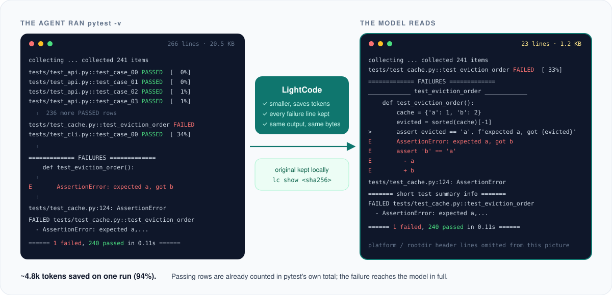
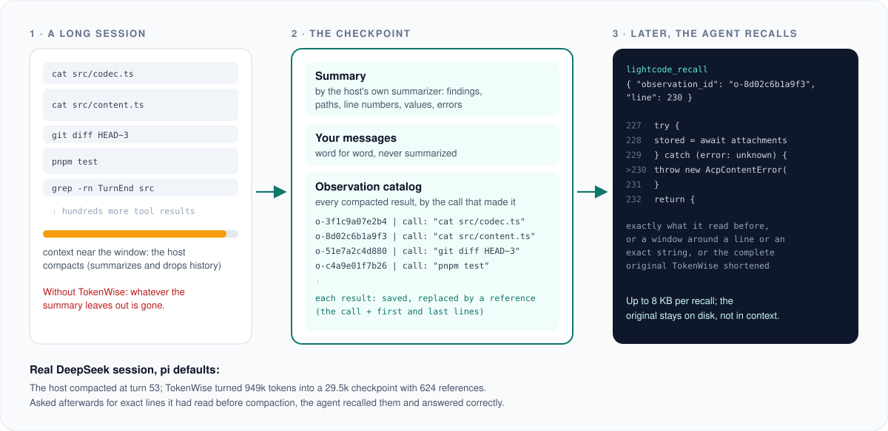

<div align="center">


# TokenWise

### Make Every Token Count for Your Agent

装进你正在用的编程 agent 的插件：让模型少读工具输出，<br>
agent 压缩历史时不丢东西，并在使用中学会你自己的工具。

<p>
  
  <a href="../../LICENSE"></a>
  
  
  
</p>

<p>
  <a href="../../README.md"></a>&nbsp;
  <a href="README.md"></a>
</p>

[为什么](#为什么需要-tokenwise) · [怎么工作](#怎么工作) · [真实效果](#真实会话里的效果) · [安装](#安装) · [支持的 agent](#支持的-agent) · [命令](#命令) · [开发](#开发)

</div>

---

## 为什么需要 TokenWise

编程 agent 的上下文窗口，大部分花在读工具输出上：测试、构建、diff、搜索、整个文件。其中大多是模型读一眼就过的噪音；也有一部分是一小时后还要用的证据，可 agent 压缩历史时，摘要往往把它漏掉了。噪音的每个 token 都在花钱、花时间、分散注意力；漏掉的每个细节，都意味着重跑一遍，或者答错。

TokenWise 从 agent 开放给插件的位置接进去，只改变一件事：**模型只读它需要的部分，其余的随时能取回。** 它不是另一个 agent，不需要任何配置，所有数据都留在你自己的电脑上。

<div align="center">

</div>

## 怎么工作

同一个思路，用在每一个花 token 的地方。

**每次工具输出都精简显示。** agent 运行 `pytest`、`cargo test`、`git diff`、`grep -rn`、`tsc`、装依赖，或其他约 80 种能识别的命令时，模型读到的是一份更短、确定的版本：通过的测试只计数不逐行列出，进度条和重复行被折叠，过长的搜索和 diff 只预览，并写明省略了多少。失败、警告、总数和退出码一律保留。完整输出存在本机，精简版末尾有一行，告诉模型需要时怎么读原文。

<div align="center">

</div>

**每次压缩都留住被删掉的内容。** 会话一长，agent 就会压缩：把较早的历史总结一下然后丢掉。有了 TokenWise，这段历史里的每个工具结果都会被保存，并换成一个引用，写明是哪条命令或哪个文件产生的。新的上下文里有摘要、你自己的原话（一字不改），以及这些引用的目录。agent 再需要某一行原文时，调用一次 `lightcode_recall` 就能读回：可以是它当时看到的原文，可以是某行或某个字符串附近的一段，也可以是精简之前的完整输出。

<div align="center">

</div>

**每次会话都在教它认识你的工具。** 内置过滤规则只认识常见命令，而你的项目有自己的构建脚本、测试工具和部署日志。你发起学习后，由你自己的 agent 研究会话里记录下的输出，为它们写小的过滤规则。TokenWise 会用所有记录过的输出重放验证；只有在学习时没见过的输出上也能省 token，才会采用这条规则。如果 agent 总要绕开某条规则去看原文，这条规则会自动关闭；任何一次采用都可以回滚。

<div align="center">

</div>

### 不变的原则

- **只会更小，否则给原文。** 精简版必须更小、并且确实省 token，才会给模型看。
- **证据不丢。** 失败详情、诊断、警告和总数都保留；过滤规则认不全的输出，原样通过。
- **结果确定。** 同样的输出永远得到同样的结果，事后也不会重新生成，所以 prompt 缓存一直有效。
- **出错就放行。** 任何环节出错，模型都拿到原文；TokenWise 改进不了的压缩，就交给 agent 自己处理。
- **只在本地。** 原文存在 `~/.lightcode`，只有你自己能读，保留 14 天。TokenWise 自己不发任何网络请求。

## 真实会话里的效果

用真实的长任务，每个 agent 都用**默认**压缩设置，一直跑到它自己压缩为止。压缩之后，agent 必须一字不差地引用压缩前读过的内容。

| Agent · 模型 | 被压缩的历史 → 模型保留的内容 | 保存的结果数 | 压缩之后 |
|---|---|---|---|
| pi · DeepSeek V4（1M） | 949k → 29.5k tokens | 624 | 取回 2 次，全部答对 |
| DeepSeek Harness · DeepSeek V4（1M） | 539k → 30.8k tokens | 589 | 取回 2 次，全部答对 |
| pi · Kimi K2.6（262k） | 274k → 8.0k tokens | 113 | 取回 3 次，全部答对 |
| OpenCode · Kimi K2.6（262k） | 190k → 7.1k tokens | 67 | 全部答对 |
| Hermes Agent · Kimi K2.6（262k） | 180k → 8.9k tokens | 83 | 取回 8 次，全部答对 |
| Grok Build · 默认模型 | 199k 的历史；在 Grok 的摘要后补上目录 | 82 | 全部答对 |
| Claude Code · 日常会话 | 661k 时自动压缩；在 Claude 的摘要后补上目录 | 202 | — |

262k 窗口的那几轮里，每个 agent 都要对照 720 KB 的规格文档修 6 个 bug，再一字不差地抄出 60 条变更请求，全部做对。CodeBuddy 跑同一个任务时根本没压缩：精简输出替它省了约 5.8 万 tokens。

## 安装

| 你的 agent | 安装 |
|---|---|
| **pi** | `pi install npm:@lightcode-ai/pi`，会话里输入 `/lightcode` |
| **DeepSeek Harness**（Web、桌面版） | **Plugins** → **Add plugin** → `@lightcode-ai/dsh` → **Install** → **Enable now** |
| **DeepSeek Harness**（终端） | `dsh plugin --profile web add @lightcode-ai/dsh` |
| **Claude Code** | `claude plugin marketplace add <checkout>` → `claude plugin install lightcode@lightcode` |
| **Codex** | `codex plugin marketplace add <checkout>` → `codex plugin add lightcode@lightcode`，再在 `/hooks` 里信任钩子 |
| **CodeBuddy** | `codebuddy plugin marketplace add <checkout>` → `codebuddy plugin install lightcode@lightcode` |
| **Grok Build** | `grok plugin marketplace add <checkout>` → `grok plugin install lightcode --trust` |
| **OpenCode** | 把 `adapters/opencode/dist/index.js` 复制到 `~/.config/opencode/plugins/lightcode.js` |
| **Hermes Agent** | 把 `adapters/hermes/lightcode` 复制到 `~/.hermes/plugins/`，执行 `hermes plugins enable lightcode` 和 `hermes config set context.engine lightcode` |
| **其他任何 agent** | `npm install -g @lightcode-ai/cli`，然后 `lc run -c 'cargo test'` |

不用配置，下一次工具调用就生效。`lc report` 查看省了多少，`lc doctor` 查看你的 agent 支持哪些功能。

> TokenWise 由一个叫 LightCode 的项目发展而来。npm 包名（`@lightcode-ai/*`）、`lc` 命令、插件 id 和 `lightcode_recall` 工具还沿用这个名字。

### 从源码安装

npm 包发布之前，可以从这里构建（需要 Node.js 22 和 pnpm），再按路径安装：

```sh
git clone https://github.com/Zongwei9888/lightcode-plugins.git tokenwise
cd tokenwise && pnpm install && pnpm build

npm install -g ./packages/cli                            # lc 命令（Claude Code、Codex、CodeBuddy、Grok、Hermes 都需要）
pi install "$PWD/adapters/pi"                            # pi
dsh plugin --profile web add "$PWD/adapters/dsh"         # DeepSeek Harness（换成你的 profile）
```

Claude Code、Codex、CodeBuddy 和 Grok 把源码目录当作插件市场来安装，详见 [`adapters/`](../../adapters) 下各自的目录。

## 支持的 agent

TokenWise 能做到多深，取决于每个 agent 允许插件做什么。在其中五个 agent 上，压缩后的上下文由 TokenWise 直接写；另外三个不允许插件替换摘要，仍由 agent 自己写，TokenWise 紧接着补上目录。

| Agent | 精简输出 | 压缩 | 学习的过滤规则 |
|---|---|---|---|
| **pi** 1.1+ | 进程内；pi 的会话保留原文 | 直接写压缩后的上下文 | 支持 |
| **DeepSeek Harness** 0.2.x | 进程内插件（Web、桌面版、CLI） | 直接写压缩后的上下文；被裁剪的结果也能取回 | 支持 |
| **OpenCode** 1.19+ | 进程内插件 | 直接写压缩后的上下文 | 支持 |
| **Hermes Agent** 0.22+ | 调用 `lc` 的 Python 插件 | 直接写压缩后的上下文（作为 context engine） | 支持 |
| **CodeBuddy** 2.175+ | 插件钩子（`lc run`） | 改写存下来的摘要 | 仅限被包装的命令 |
| **Claude Code** 2.1+ | 插件钩子 | 在 Claude 的摘要后补目录 | 支持 |
| **Codex** 0.162+ | 插件钩子（`lc run`） | 在 Codex 的摘要后补目录 | 仅限被包装的命令 |
| **Grok Build** 1.0+ | 插件钩子 | 在 Grok 的摘要后补目录 | 支持 |
| **其他 agent 或 shell** | `lc run -c '<命令>'` | 通过 `lc mcp` 取回（任何 MCP 客户端） | 支持 |

测试在 macOS 和 Linux 上运行，Windows 还没有测试。接入新的 agent 只需要在同一个核心上写一个很薄的适配层，做法见 [docs/adapters.md](../adapters.md)。

<details>
<summary>在 pi 和 DeepSeek Harness 里：面板、学习、回滚</summary>

**pi**：`/lightcode` 打开一个面板，显示本次会话省了多少、学到的过滤规则，以及值得学习的命令。按 `l` 开始学习，按 `r` 回滚一次采用。

<p align="center"></p>

**DeepSeek Harness**（Web 和桌面版）：插件页面上有 **Learn now**、实时进度、带开关和 **Roll back** 的已学规则列表；有值得学习的新输出时会弹出提示。

<p align="center"></p>

截图来自端到端测试：用一个脚本化的模型驱动真实的应用。

</details>

## 命令

```
lc report [--host H] [--session S] [--json]   按会话或 agent 查看省了多少
lc doctor [--json]                            配置，以及每个 agent 支持什么
lc run -c '<命令>'                            运行命令，输出精简后的结果
lc recall <id> [--query Q | --line N] [--original]
                                              读回一个保存的结果
lc mcp                                        提供取回工具的 MCP 服务，任何 agent 都能用
lc evolve --learner pi|dsh|claude|codex|"<命令>"
                                              从记录的输出里学习过滤规则
lc rules [list|show|off|rollback]             已学的过滤规则
lc filters · lc show <sha256> · lc gc         内置规则、查看一份原文、清理
```

## 配置

不需要配置。想改的话，写在 `~/.lightcode/config.json`：

```json
{
  "economy": { "mode": "apply", "minimumSavedTokens": 16, "evidence": true, "learnedRules": true },
  "lightshadow": { "mode": "apply" },
  "artifacts": { "retentionDays": 14 }
}
```

`economy` 管精简输出和学习，`lightshadow` 管压缩；每项可设为 `apply`、`observe`（只记录会改什么，不实际改动）或 `off`。项目里的 `.lightcode/config.json` 只能往低调。`LIGHTCODE_DISABLE=1` 关闭全部功能。

## 隐私

所有数据都留在本机。保存的原文可能包含命令打印出来的任何内容，包括密钥；这些文件只有你自己能读，过了保留期就删除。唯一会离开本机的，是你亲自发起的学习：学习者是你自己的 agent，所以它读到的记录会发给这个 agent 的模型服务商，和 agent 当初运行这些命令时一样。设置 `"evidence": false` 就不记录任何内容。

## 怎么测试的

| 层级 | 内容 |
|---|---|
| 单元测试 | 1,095 个，覆盖核心和每个适配层；agent 的事件数据和会话记录都取自真实 agent |
| 一致性测试 | 每个实现都必须逐字节复现预期的精简输出 |
| 端到端测试 | 把打包好的插件装进已发布的 pi 和 DeepSeek Harness，通过它们自己的界面操作；在 CI 的 Linux 和 macOS 上运行 |
| 真实模型 | 8 个 agent 的长会话，分别用默认和调低的压缩阈值，压缩后要求一字不差地引用原文 |

## 开发

```sh
pnpm install
pnpm check        # 类型检查、构建、全部单元测试
pnpm e2e          # 装进已发布的 agent 版本，跑真实会话
```

```
packages/core        过滤规则、学习规则的沙箱、source map，不依赖任何 agent
packages/protocol    能力、agent 描述、协商、日志格式
packages/store       日志、保存的原文、学到的规则、配置
packages/mechanisms  精简输出、压缩、学习
packages/cli         lc 命令
adapters/<agent>     每个 agent 一个很薄的适配层
conformance/         逐字节对照的测试语料
e2e/                 针对已发布 agent 版本的端到端测试
```

设计：[docs/architecture.md](../architecture.md) · 接入新 agent：[docs/adapters.md](../adapters.md) · 发布：[docs/releasing.md](../releasing.md) · 变更：[CHANGELOG.md](../../CHANGELOG.md)

## 许可证

MIT。`packages/core/src/rtk/` 中的 RTK 过滤数据为 Apache-2.0，见 [`third-party/rtk`](../../third-party/rtk/NOTICE.md)。
