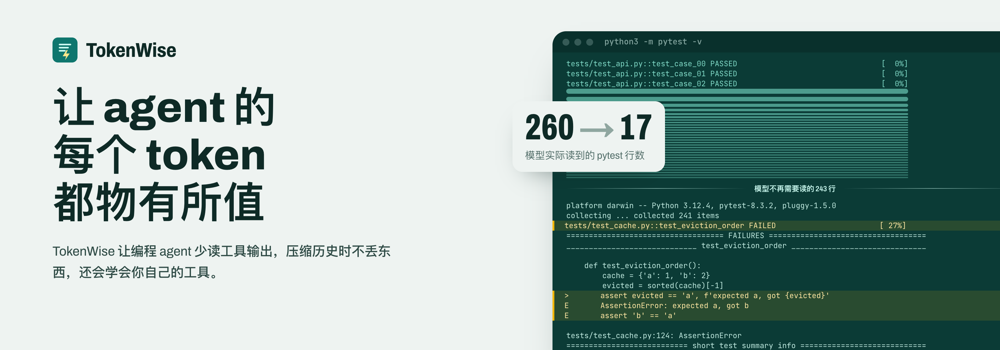
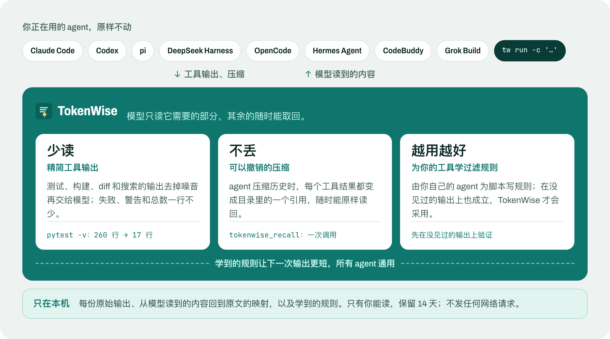
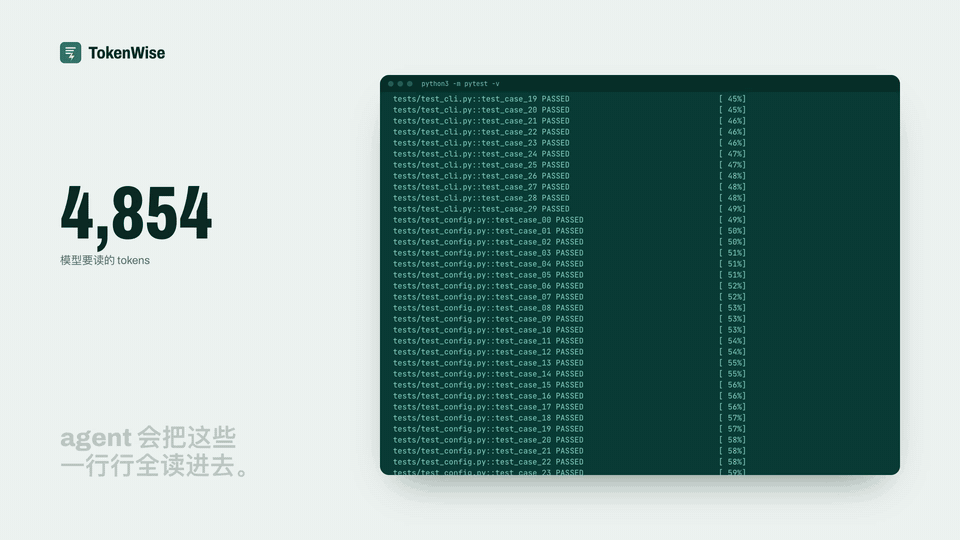
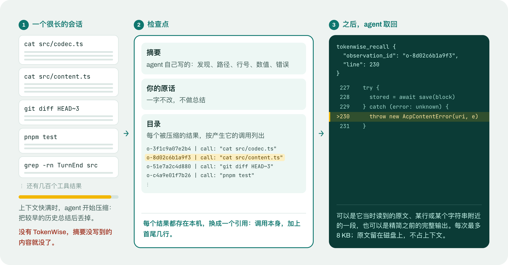
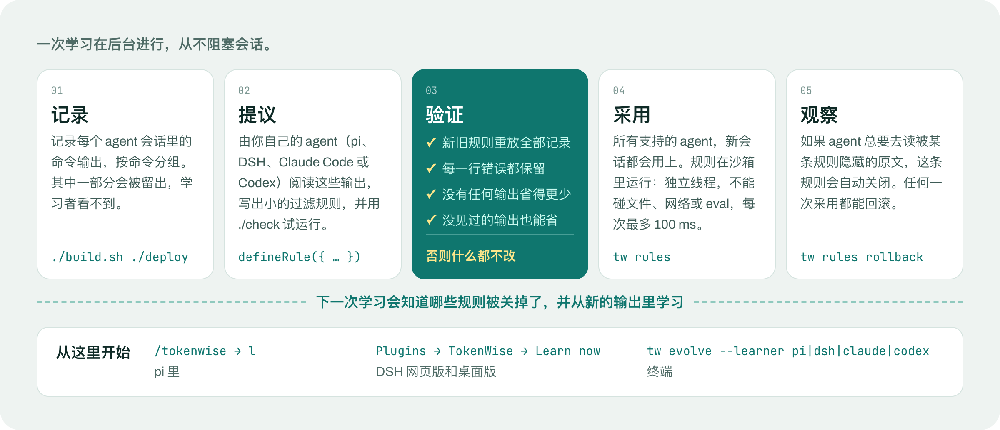

<div align="center">



<p>
  
  <a href="../../LICENSE"></a>
  
  
  
</p>

[English](../../README.md) · **简体中文**

[观看 1 分钟视频](../../media/video/tokenwise-zh.mp4) · [English video](../../media/video/tokenwise-en.mp4)

</div>

---

编程 agent 的上下文窗口，大部分花在读工具输出上：测试、构建、diff、搜索、整个文件。其中大多是模型读一眼就过的噪音；也有一部分是一小时后还要用的证据，可 agent 压缩历史时，摘要往往把它漏掉了。噪音花的是钱、时间和注意力；漏掉的细节，换来的是重跑一遍，或者答错。

TokenWise 接进你正在用的 agent，只改变一件事：**模型只读它需要的部分，其余的随时能取回。** 它不是另一个 agent，不需要任何配置，所有数据都留在你自己的电脑上。

<p align="center"></p>

## 怎么工作

### 少读

agent 运行 `pytest`、`cargo test`、`git diff`、`grep -rn`、`tsc`、装依赖，或其他约 80 种能识别的命令时，模型读到的是一份更短、结果确定的版本：通过的测试只计数、不逐行列出，进度条和重复行被折叠，过长的搜索和 diff 只预览，并写明省略了多少。失败、警告、总数和退出码一律保留。完整输出存在本机，精简版末尾有一行，告诉模型需要时怎么读原文。

<p align="center"></p>

### 不丢

会话一长，agent 就会压缩：把较早的历史总结一下，然后丢掉。有了 TokenWise，这段历史里的每个工具结果都会被保存，并换成一个引用，写明是哪次调用产生的。新的上下文里有摘要、你自己的原话（一字不改），以及这些引用的目录。agent 再需要某一行原文时，调用一次 `tokenwise_recall` 就能读回：可以是它当时看到的原文，可以是某行或某个字符串附近的一段，也可以是精简之前的完整输出。

<p align="center"></p>

### 越用越好

内置过滤规则认识常见命令，而你的项目有自己的构建脚本、测试工具和部署日志。你发起学习后，由你自己的 agent 研究会话里记录下的输出，为它们写小的过滤规则。TokenWise 会用所有记录过的输出重放验证；只有在学习时没见过的输出上也能省 token，才会采用这条规则。如果 agent 总要绕开某条规则去看原文，这条规则会自动关闭；任何一次采用都可以回滚。

<p align="center"></p>

### 始终不变的原则

- **只会更小，否则给原文。** 精简版必须更小、并且确实省 token，才会交给模型。
- **证据不丢。** 失败详情、诊断、警告和总数都保留；过滤规则认不全的输出，原样通过。
- **结果确定。** 同样的输出永远得到同样的结果，事后也不会重新生成，所以 prompt 缓存一直有效。
- **出错就放行。** 任何环节出错，模型都拿到原文；TokenWise 改进不了的压缩，交给 agent 自己处理。
- **只在本地。** 原文存在 `~/.tokenwise`，只有你自己能读，保留 14 天。TokenWise 自己不发任何网络请求。

## 安装

TokenWise 还没有发布到 npm，需要先从源码构建一次（需要 Node.js 22 和 pnpm）：

```sh
git clone https://github.com/Zongwei9888/tokenwise.git
cd tokenwise && pnpm install && pnpm build
npm install -g ./packages/cli          # tokenwise 命令，简写为 tw
```

然后在同一个目录下，装进你的 agent：

```sh
# pi
pi install "$PWD/adapters/pi"

# DeepSeek Harness：网页版、桌面版和 CLI（profile 换成你自己的）
dsh plugin --profile web add "$PWD/adapters/dsh"

# Claude Code
claude plugin marketplace add "$PWD" && claude plugin install tokenwise@tokenwise

# Codex：装好后在 /hooks 里信任钩子
codex plugin marketplace add "$PWD" && codex plugin add tokenwise@tokenwise

# CodeBuddy
codebuddy plugin marketplace add "$PWD" && codebuddy plugin install tokenwise@tokenwise

# Grok Build
grok plugin marketplace add "$PWD" && grok plugin install tokenwise --trust

# OpenCode
mkdir -p ~/.config/opencode/plugins
cp adapters/opencode/dist/index.js ~/.config/opencode/plugins/tokenwise.js

# Hermes Agent
mkdir -p ~/.hermes/plugins
cp -R adapters/hermes/tokenwise ~/.hermes/plugins/tokenwise
hermes plugins enable tokenwise && hermes config set context.engine tokenwise

# 其他任何 agent：用它包一层命令
tokenwise run -c 'cargo test'
```

不用配置，下一次工具调用就生效。`tokenwise report` 查看省了多少，`tokenwise doctor` 查看你的 agent 支持哪些功能。各 agent 的细节见 [`adapters/`](../../adapters) 下对应的目录。

## 支持的 agent

TokenWise 能做到多深，取决于每个 agent 允许插件做什么。

| Agent | 精简输出 | 压缩 | 学习的过滤规则 |
|---|---|---|---|
| **pi** 1.1+ | 进程内 | 直接写检查点 | 支持 |
| **DeepSeek Harness** 0.2.x | 进程内 | 直接写检查点 | 支持 |
| **OpenCode** 1.19+ | 进程内 | 直接写检查点 | 支持 |
| **Hermes Agent** 0.22+ | Python 插件 | 直接写检查点 | 支持 |
| **CodeBuddy** 2.175+ | 钩子，经由 `tokenwise run` | 改写存下来的摘要 | 仅限被包装的命令 |
| **Claude Code** 2.1+ | 钩子 | 补上目录 | 支持 |
| **Codex** 0.162+ | 钩子，经由 `tokenwise run` | 补上目录 | 仅限被包装的命令 |
| **Grok Build** 1.0+ | 钩子 | 补上目录 | 支持 |
| **其他 agent 或 shell** | `tokenwise run` | 通过 MCP 取回 | 支持 |

**直接写检查点**：压缩后的上下文由 TokenWise 自己生成。**补上目录**：摘要仍由 agent 自己写（这些 agent 不允许插件替换），TokenWise 紧接着补上目录。

测试在 macOS 和 Linux 上运行，Windows 还没有测试。接入新的 agent 只需要在同一个核心上写一个很薄的适配层，做法见 [docs/adapters.md](../adapters.md)。

<details>
<summary>在 pi 和 DeepSeek Harness 里：面板、学习、回滚</summary>
<br>

在 **pi** 里，`/tokenwise` 打开一个面板，显示本次会话省了多少、学到的过滤规则，以及值得学习的命令。按 `l` 开始学习，按 `r` 回滚一次采用。

在 **DeepSeek Harness**（网页版和桌面版）里，插件页面上有 **Learn now**、实时进度、带开关和 **Roll back** 的已学规则列表；有值得学习的新输出时会弹出提示。

<p align="center"></p>

截图来自端到端测试：用一个脚本化的模型驱动真实的应用。

</details>

## 命令

| 命令 | 作用 |
|---|---|
| `tokenwise report [--host H] [--session S] [--json]` | 按会话或 agent 查看省了多少 |
| `tokenwise doctor [--json]` | 查看配置，以及每个 agent 支持什么 |
| `tokenwise run -c '<命令>'` | 运行命令，输出精简后的结果 |
| `tokenwise recall <id> [--query Q \| --line N] [--original]` | 读回一个保存的结果 |
| `tokenwise mcp` | 提供取回工具的 MCP 服务，任何 agent 都能用 |
| `tokenwise evolve --learner pi\|dsh\|claude\|codex\|"<命令>"` | 从记录的输出里学习过滤规则 |
| `tokenwise rules [list\|show\|off\|rollback]` | 管理学到的过滤规则 |
| `tokenwise filters`、`show <sha256>`、`gc` | 内置规则、查看一份原文、清理 |

所有命令里的 `tokenwise` 都可以写成 `tw`。

## 配置

不需要配置。想改的话，写在 `~/.tokenwise/config.json`：

```json
{
  "output": { "mode": "apply", "minimumSavedTokens": 16, "evidence": true, "learnedRules": true },
  "compaction": { "mode": "apply" },
  "artifacts": { "retentionDays": 14 }
}
```

`output` 管精简输出和学习，`compaction` 管压缩。每项可设为 `apply`、`observe`（只记录会改什么，不实际改动）或 `off`。项目里的 `.tokenwise/config.json` 只能往低调；`TOKENWISE_DISABLE=1` 关闭全部功能。

## 隐私

所有数据都留在本机。保存的原文可能包含命令打印出来的任何内容，包括密钥，所以这些文件只有你自己能读，过了保留期就删除。唯一会离开本机的，是你亲自发起的学习：学习者是你自己的 agent，它读到的记录会发给这个 agent 的模型服务商，和 agent 当初运行这些命令时一样。设置 `"evidence": false` 就不记录任何内容。

## 怎么测试的

| 层级 | 内容 |
|---|---|
| 单元测试 | 1,095 个，覆盖核心和每个适配层；agent 的事件数据和会话记录都取自真实 agent |
| 一致性测试 | 每个实现都必须逐字节复现预期的精简输出 |
| 端到端测试 | 把打包好的插件装进已发布的 pi 和 DeepSeek Harness，通过它们自己的界面操作；在 CI 的 Linux 和 macOS 上运行 |
| 真实模型 | 8 个 agent 的长会话，分别用默认和调低的压缩阈值，压缩后要求一字不差地引用原文 |

## 开发

```sh
pnpm install
pnpm check        # 类型检查、构建、全部单元测试
pnpm e2e          # 装进已发布的 agent 版本，跑真实会话
```

| 路径 | 内容 |
|---|---|
| `packages/core` | 过滤规则、学习规则的沙箱、source map；不依赖任何 agent |
| `packages/protocol` | 能力、agent 描述、协商、日志格式 |
| `packages/store` | 日志、保存的原文、学到的规则、配置 |
| `packages/mechanisms` | 精简输出、压缩、学习 |
| `packages/cli` | `tokenwise` 命令 |
| `adapters/<agent>` | 每个 agent 一个很薄的适配层 |
| `conformance/` | 逐字节对照的测试语料 |
| `e2e/` | 针对已发布 agent 版本的端到端测试 |

延伸阅读：[架构](../architecture.md)、[接入新 agent](../adapters.md)、[发布流程](../releasing.md)、[宣传素材](../../media/README.md)、[变更记录](../../CHANGELOG.md)。

## 许可证

MIT。`packages/core/src/rtk/` 中的 RTK 过滤数据为 Apache-2.0，见 [`third-party/rtk`](../../third-party/rtk/NOTICE.md)。
