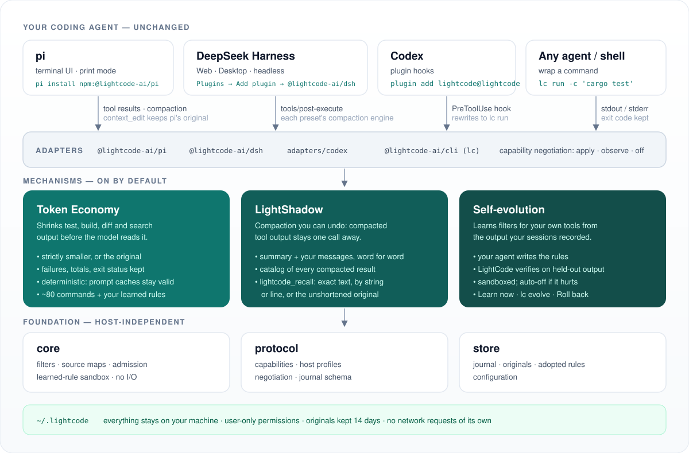
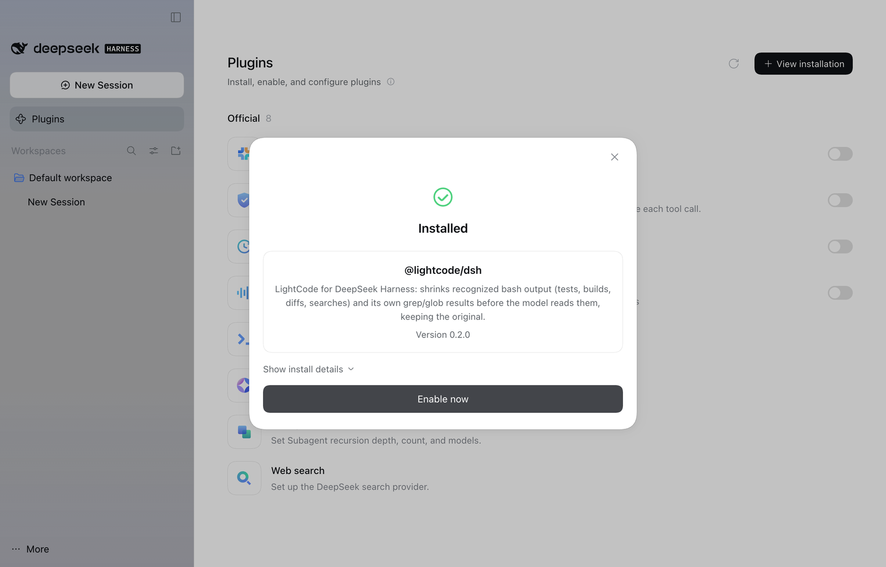
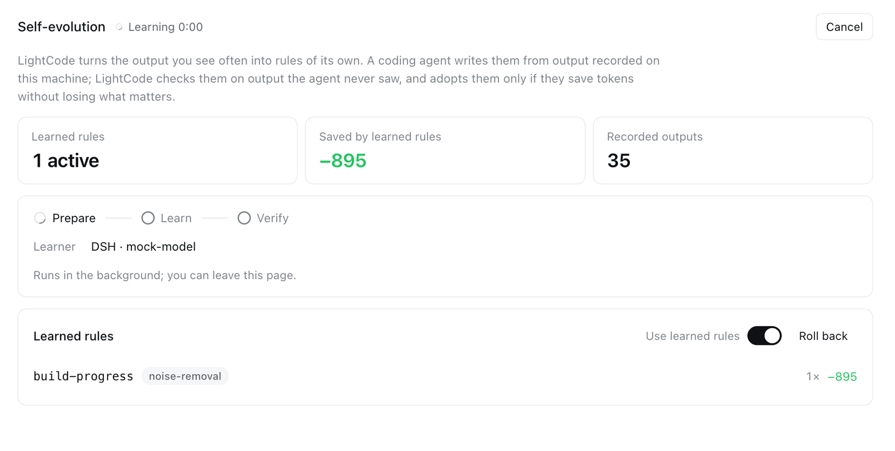
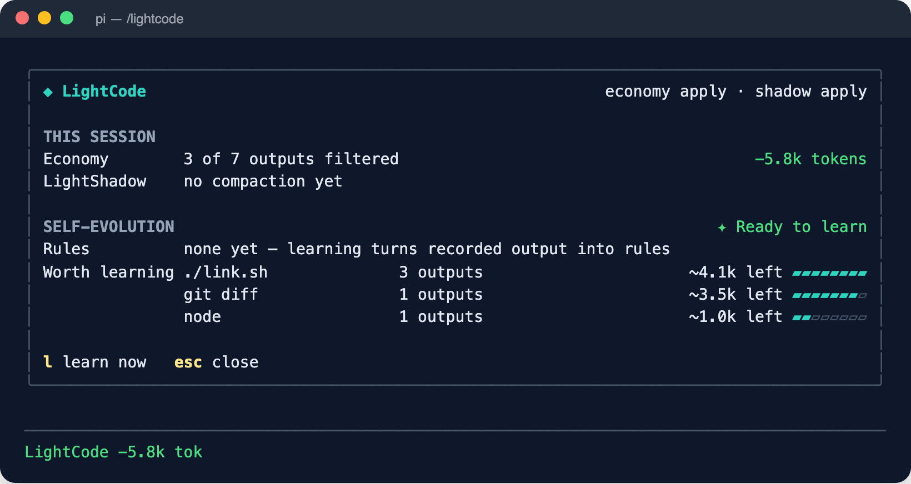
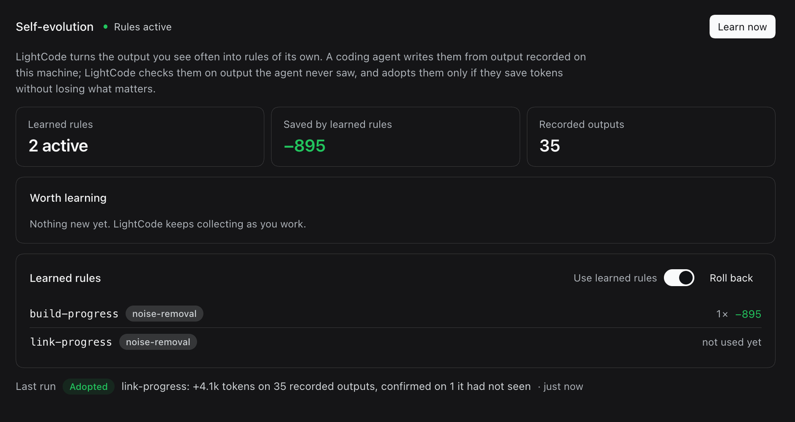

<div align="center">


# LightCode

### 工具输出少花 token，证据一点不丢。

给 [pi](https://github.com/earendil-works/pi)、DeepSeek Harness 和 [Codex](https://github.com/openai/codex) 用的插件：精简模型要读的输出，<br>让历史压缩可以找回，并为你自己的工具学习新的过滤规则。

<p>
  
  <a href="../../LICENSE"></a>
  
  
  
</p>
<p>
  
  
  
  
</p>

<p>
  <a href="../../README.md"></a>&nbsp;
  <a href="README.md"></a>
</p>

</div>

---

> **状态：0.2 开发中。** Token Economy、LightShadow 和自进化过滤规则以 pi 和 DeepSeek Harness 插件的形式提供，默认全部开启。Codex 通过插件获得 Token Economy，其他 Agent 用 `lc run`。委派记账计划在 0.3。尚未发布到 npm，在此之前请[从源码安装](#从源码安装)。

## 📰 动态

- **2026-10-15** LightShadow 在真实的约 100 万 token DeepSeek 长会话上、用两个宿主的默认压缩设置通过测试；DeepSeek Harness 会在有新输出值得学习时提示。
- **2026-10-14** 🧬 自进化过滤规则：可以从 pi 的 `/lightcode` 面板、DeepSeek Harness 的插件页或 `lc evolve` 开始学习。
- **2026-10-14** 🌗 LightShadow：pi 和 DeepSeek Harness 上可找回的历史压缩。
- **2026-10-13** 🧩 pi 和 DeepSeek Harness（网页版、桌面版、命令行）的可安装插件，以及针对已发布宿主版本的端到端测试。

## ✨ 为什么用 LightCode

编码 Agent 的上下文大多花在工具输出上：测试、构建、diff、搜索、读文件。其中大部分是模型只看一眼的噪声；也有一部分是证据，被宿主压缩掉以后 agent 还需要再看。LightCode 通过宿主提供的插件接口接入你正在用的 Agent，做三件事：

- **Token Economy**：给模型看可识别输出的精简、确定性版本，保留每条失败、警告和汇总，原文存在本机。
- **LightShadow**：宿主压缩长会话时，工具输出存档并列出目录，而不是丢掉；agent 一次工具调用就能读回任意一条。
- **自进化**：由你自己的 agent 为*你的*构建脚本和日志写过滤规则；只有在学习者没见过的输出上验证通过，LightCode 才会采用。

它不是另一个 Agent，所有数据都在本机（只有你主动开始的学习会把记录的输出发给你自己 agent 的模型）。出错即放行：任何环节出问题，模型都拿到原文。

<div align="center">

</div>

## 🚀 快速开始

| 你的 Agent | 安装 |
|---|---|
| **pi** | `pi install npm:@lightcode/pi`，会话里输入 `/lightcode` |
| **DeepSeek Harness**（网页版、桌面版） | **插件** → **添加插件** → `@lightcode/dsh` → **安装** → **立即启用** |
| **DeepSeek Harness**（终端） | `dsh plugin --profile web add @lightcode/dsh`（需要 pnpm 11+） |
| **Codex** | `codex plugin marketplace add <仓库>` → `codex plugin add lightcode@lightcode`，再在 `/hooks` 里信任钩子 |
| **其他** | `npm install -g @lightcode/cli`，然后 `lc run -c 'cargo test'` |

无需配置：Economy 和 LightShadow 从下一次工具调用起生效。`lc report` 查看省了多少，`lc doctor` 查看每个宿主支持什么。

### 从源码安装

npm 包发布之前，从本仓库构建（需要 Node.js 22 和 pnpm），按路径安装：

```sh
git clone https://github.com/Zongwei9888/lightcode-plugins.git lightcode
cd lightcode && pnpm install && pnpm build

pi install "$PWD/adapters/pi"                            # pi
dsh plugin --profile web add "$PWD/adapters/dsh"         # DeepSeek Harness（换成你用的 profile）
npm install -g ./packages/cli                            # lc 命令
```

DeepSeek Harness 桌面版：先退出应用，再用它自带的 `dsh` 加 `--profile desktop`。Codex 从源码以 marketplace 方式安装，见 [`adapters/codex`](../../adapters/codex/README.md)。

## 🖥️ 界面

**pi**：`/lightcode` 打开面板，显示本会话省下的 token、LightShadow、学到的规则和值得学习的命令。按 `l` 开始学习，面板会跟随进度，`r` 回滚。

<div align="center">

</div>

**DeepSeek Harness**（网页版和桌面版）：像其他插件一样在 **插件** 页安装；插件页有“自进化”一节：**开始学习**、实时进度、学到的规则（可开关、可**回滚**），学习结束时弹出提示。

<div align="center">

</div>

<details>
<summary>更多截图：安装、学习进行中、学习前的 pi 面板、深色主题</summary>

<p align="center">




</p>

</details>

截图来自端到端测试（`pnpm e2e`），测试驱动真实的 DeepSeek Harness 桌面版和 pi 终端界面，模型是脚本模拟的。

## 🔍 工作原理

### Token Economy

<div align="center">

</div>

Agent 运行 `pytest`、`cargo test`、`git diff`、`grep -rn`、`tsc`、`find`、依赖安装等约 80 类常见命令时，LightCode 把模型要读的输出替换成确定性的**投影**：通过的测试行只计数不逐条列出，进度条和重复行折叠，过大的搜索结果和 diff hunk 用预览加明确的省略计数表示。宿主自带的搜索工具（pi 的 `grep`、`find`，DeepSeek Harness 的 `grep`、`glob`）的结果做无损排版：同一文件的匹配、同一目录的路径归到一起，每条匹配、行号和路径都保留。

不变的规则：

- **严格变小才使用**：投影的 UTF-8 字节数和 Token 都必须更小，否则交付原文。
- **证据保留**：失败详情、诊断、警告、未知行、汇总和退出状态都保留；无法完整识别的输出原样通过；失败的命令绝不会被概括成 "ok"。
- **确定性、首次可见即定型**：同一输入总是得到同样的字节，已交付的结果不会再被重算，前缀缓存保持有效。
- **原文保留**：pi 在自己的会话文件里保留原文；所有宿主上 LightCode 都会把原文私下存一份（`~/.lightcode`，仅本人可读，默认保留 14 天），并保存投影到原文的源映射。
- **出错即放行**：LightCode 自身出任何错，都交付原文。

### LightShadow

<div align="center">

</div>

会话变长后宿主会压缩历史：让模型把较早的对话写成摘要，然后丢掉原文，摘要没写进去的工具输出就再也看不到了。装了 LightShadow 后，pi 或 DeepSeek Harness 压缩时：

- 宿主自己的摘要器照常读这段内容写摘要，但会被要求记下继续工作需要的结论（路径、行号、数值、报错），而不是整段文件或日志；
- 这段里的每条工具结果都存到本地，换成一个引用，写明是哪条命令或哪个文件产生的，并带简短摘录（首尾几行，最多 320 字节）；存档目录列出长会话里的全部引用（预算为这段的 8%，最近 40 条带摘录）；
- 替换这段历史的检查点 = 摘要 + **你说过的话原文** + 引用目录；
- 模型可以用 `lightcode_recall` 工具把任意一条重新读回来：和当初看到的一字不差，或按给定字符串、按行号取最多 8 KB 的窗口（按行号取时每行带行号，并标出所请求的那一行）；如果当初被 Token Economy 精简过，还可以取完整原文；
- DeepSeek Harness 把超长结果截成首尾两段时，完整内容也会保存，截断提示里写明用哪个编号找回。

检查点没有变小、或任何环节出错，都交还给宿主按原方式压缩。

### 自进化过滤规则

<div align="center">

</div>

内置过滤器覆盖常见工具，但每个项目都有自己的构建脚本、测试工具、日志格式。LightCode 把见过的 shell 输出存作证据，在你需要时于后台学习新规则：

- **pi**：输入 `/lightcode` 打开面板，可以看到本会话省下的 token、学到的规则和各自省了多少、值得学习的命令、正在进行的学习。按 `l` 开始学习（学习者就是 pi 自己，使用当前会话的模型），底部状态栏显示进度，结束时 pi 会提示。
- **DeepSeek Harness（网页版和桌面版）**：插件 → LightCode 页面有“自进化”一节：**开始学习**（学习者是 DSH headless，使用你的默认模型）、实时进度、学到的规则（可开关、可**回滚**）；有新的输出值得学习时、学习结束时都会弹出提示。
- **任何终端**：`lc evolve`。

学习在独立进程里运行，不会卡住会话；同一时间只运行一个，20 分钟自动停止，也可以随时取消；采用的规则在正在运行的会话里从下一条输出起生效。每次学习：

```sh
lc evolve --learner pi          # 也可以是 dsh、claude、codex 或任意命令
```

1. **证据**：最近会话里还有压缩空间的输出（出现最多的优先）写进一个工作区；全部证据另存一份，用于验证，学习者看不到。
2. **提出**：你自己的编码 agent 在工作区里当学习者，读证据、写或改规则（很短的 JavaScript 函数，写法见工作区里的 `RULES.md`），过程中可以随时运行 `./check` 和 `./try`。
3. **验证**：LightCode 用当前规则和新规则把**所有**记录过的输出重放一遍，并检查一组“必须保留的信息”（看起来像排版的字面数据、看起来像测试进度的程序输出、失败证据等）。只有全部满足、没有规则出错、总体更省、**没有任何一条输出变得更费**，并且被改进的命令在**学习者从没见过的输出**上也更省（只贴合样本的规则会被拒绝），才会采用。
4. **观察**：使用中，如果 agent 总是要找回某条学到的规则藏掉的原文（同一条规则被找回原文 3 次，且至少占使用次数的 1/5），这条规则会被自动关闭，记作一次可以回滚的变更；下一次学习会被告知。

采用的规则在之后的新会话里、在所有宿主上先于内置过滤器运行，跑在沙箱里（不能访问文件、网络、`require`、定时器或 `eval`，每次调用限 100 ms）；如果某条规则的结果删掉了包含 error、warning、failure 等字样的行，或者源映射和输出对不上，这次结果直接作废。`lc rules` 可以查看、关闭、回滚。

## 🧩 宿主

| 宿主 | 安装 | 接入方式 | Economy | LightShadow | 学到的规则 |
|---|---|---|---|---|---|
| **pi** 1.1+ | `pi install npm:@lightcode/pi` | 进程内扩展；通过 `context_edit` 交付投影，pi 会话保留原文；压缩走 `session_before_compact` | 应用 | 应用 | 支持 |
| **DeepSeek Harness** 0.2.x | 插件 → 添加插件 → `@lightcode/dsh`，或 `dsh plugin --profile web add @lightcode/dsh` | 进程内插件（`tools/post-execute`）；压缩接入每个 agent 预设自己的压缩模块；插件页可切换模式 | 应用 | 应用 | 支持 |
| **Codex** 0.162+ | `codex plugin marketplace add <仓库>`，再 `codex plugin add lightcode@lightcode` | 插件的 `PreToolUse` 钩子把可识别的命令改写为 `lc run -c '<命令>'`；模型历史里仍是原命令 | 应用 | —（Codex 不允许插件接管压缩） | 仅限钩子改写的命令 |
| **任何 Agent / 终端** | `npm install -g @lightcode/cli` | 直接调用 `lc run -c '<命令>'` | 应用 | — | 支持 |

`lc evolve` 和 `lc rules` 随 `@lightcode/cli` 提供。

pi 和 DeepSeek Harness 插件已在 macOS 和 Linux 上测试（DSH 桌面版在 macOS 上测试）；Windows 尚未测试。两个插件在子 agent 里同样生效（DSH 的内置 `subagent` / `subagent_fork`；pi 上每个子 agent 单独起 `pi` 进程的子 agent 扩展），会话的 `/lightcode` 会把子 agent 省下的一起算上。

`lc doctor` 会列出每个宿主支持什么以及原因（能力协商：每个机制按宿主能力以 `apply` / `observe` / `off` 运行，配置只能降级不能强开）。

#### pi

`pi install npm:@lightcode/pi` 安装。状态栏显示本会话省下的 token，`/lightcode` 查看明细，`pi --lightcode observe` 本次只记录不改动，`pi config` 可关闭扩展。详见 [adapters/pi](../../adapters/pi/README.md)。

#### DeepSeek Harness

Web 界面或桌面版：侧边栏 **插件** → **添加插件** → 输入 `@lightcode/dsh` → **安装** → **立即启用**；或终端执行 `dsh plugin --profile web add @lightcode/dsh`（`dsh plugin` 需要 pnpm 11 及以上）。会话里输入 `/lightcode` 查看省下的 token；插件详情页的 **模式**（精简 / 只记录 / 关闭）保存后对下一次工具调用生效，无需重启。详见 [adapters/dsh](../../adapters/dsh/README.md)。

## ⌨️ 常用命令

```
lc run -c 'cargo test'      用你的 shell 执行，输出精简结果；退出码和信号原样透传
lc report                   节省统计、各过滤器贡献、最常见的未覆盖命令
lc doctor                   配置与各宿主的能力协商结果
lc filters                  所有过滤器及其保留的内容
lc show <sha256>            查看保存的原文
lc gc [--days N]            清理过期原文
lc evolve --learner pi      用证据学新规则，验证通过才采用（--dry-run 只验证不采用）
lc rules [list|show|off|rollback]   查看、关闭、回滚学到的规则
```

全部关闭：`LIGHTCODE_DISABLE=1`；单独调整：`LIGHTCODE_ECONOMY`、`LIGHTCODE_LIGHTSHADOW`（`apply|observe|off`）。配置文件为 `~/.lightcode/config.json`，格式见英文 README（`economy.evidence` 控制是否保存证据，`economy.learnedRules` 控制是否使用学到的规则，`lightshadow.mode` 控制 LightShadow）。项目里的 `.lightcode/config.json` 只能调低模式或关闭功能，不能重新打开你在自己配置里关掉的功能。

## 🔒 隐私

所有数据只在本机。保存的原文可能包含命令打印出的任何内容（包括密钥），文件仅本人可读，并按保留期删除。LightCode 不发起任何网络请求。唯一的例外是你自己运行的 `lc evolve`：学习者就是你的编码 agent，它读到的证据（最近的命令输出）会发给该 agent 使用的模型服务，和当初 agent 运行这些命令时一样。把 `economy.evidence` 设为 `false` 就完全不保存证据。

## ✅ 如何测试

| 层级 | 内容 |
|---|---|
| 单元测试 | core、protocol、store、mechanisms、cli 以及 pi 和 DSH 适配器共 961 个测试；pi 的测试运行真实的 pi 会话（模型为脚本模拟） |
| 一致性 | `conformance/economy`：每个实现都必须逐字节复现预期的投影 |
| 端到端 | `pnpm e2e` 把打包好的插件从本地 registry 装进已发布的 pi 和 DeepSeek Harness（两个网页版版本和桌面版），通过宿主自己的插件命令和界面操作；本地 51 项检查，CI 在 Linux 和 macOS 上运行（桌面版除外） |
| 真实模型 | 用宿主**默认**压缩设置跑 DeepSeek 长会话，直到宿主自己触发压缩；之后要求 agent 引用压缩前读过的原文 |

真实 DeepSeek 长会话的结果（LightShadow 检查点、引用数、找回）：

| 宿主 | 被压缩的段 → 检查点 | 引用 | 压缩之后 |
|---|---|---|---|
| pi | 约 94.9 万 → 2.95 万 tokens | 624 | 按行号找回 2 次，所有问题回答正确 |
| DeepSeek Harness | 约 53.9 万 → 3.08 万 tokens | 589 | 找回 2 次，所有问题回答正确 |

## 📄 许可证

MIT。`packages/core/src/rtk/` 中的 RTK 内置过滤数据为 Apache-2.0，见 [`third-party/rtk`](../../third-party/rtk/NOTICE.md)。架构说明见 [architecture.md](../architecture.md)（英文）。
